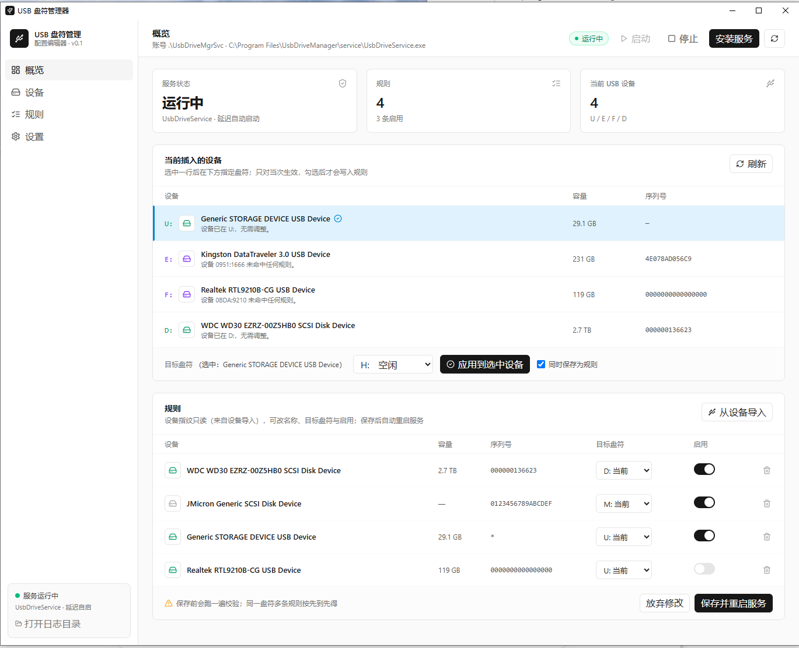
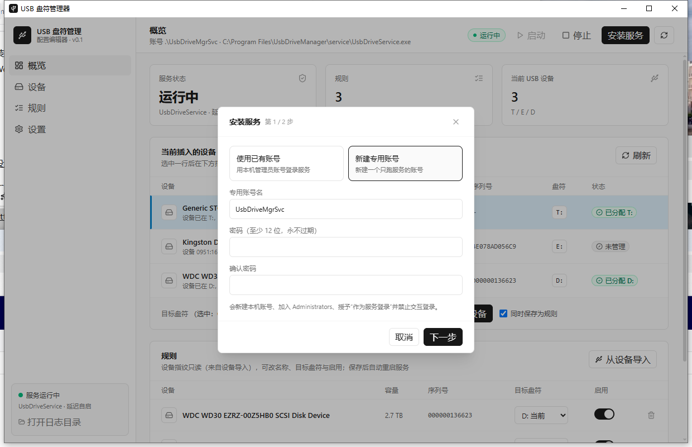

## USBOrder 0.2.7

Windows 无人值守机器用的 U 盘盘符管理工具：按设备指纹（VID/PID + 序列号）把固定盘符分配给指定 U 盘，插上就是你要的盘符。

### 为什么要升级

0.2.6 上线后实测发现：一块 3TB USB 硬盘（绿联 VL71x 盒子 / VIA `2109:0715` UAS 桥接）从原 USB 口换到另一个口后，Windows 反复播插入/拔出提示音、盘符不识别，换回原口立刻恢复。而故障时段的服务日志一片空白，无法判断是「盘没被枚举出来」还是「规则没命中」，只能靠猜。

现场取证（Windows 系统日志 + PnP 设备树 + 设备电源能力）结论：

- **掉线的直接原因不在本程序**。该桥接芯片 `CM_POWER_DATA.Capabilities = 0x19`：只支持 D0/D3 与 `WAKE_FROM_D0`，**不具备 `WAKE_FROM_D3`**；而系统「USB 选择性暂停」处于开启状态（`DeviceSelectiveSuspended = 1`）。芯片一旦被挂进 D3 就无法自主唤醒，只能等主机 xHCI 端口恢复；部分端口恢复时序过不了，就会 reset → 重新枚举 → 反复插拔音。硬盘盒固件自带的 idle 休眠只是触发条件。
- **但程序侧确实有 5 个该修的缺陷**（见下），尤其是日志不留证据、设备抖动时跟着反复全量枚举——正是这次排查踩到的坑。

因此 0.2.7 做两件事：补齐设备身份匹配与抗抖动能力，并把「盘在不在、指纹是什么、为什么没命中」完整写进日志。**掉盘本身还需在系统侧关闭 USB 选择性暂停**，见下方「升级后必做」。

### 修复了什么 Bug

| # | 问题 | 修复 |
|---|---|---|
| 1 | 设备指纹绑定了随 USB 口浮动的 PnP 父链值：换口 / 换控制器后 VID/PID 漂移，规则静默失配，盘不会被改回固定盘符 | `AppConfig.FindMatch` 改为两轮匹配：精确指纹优先；未命中时用**稳定序列号**回退（两侧序列号都必须稳定、且规则集内唯一） |
| 2 | 未校验序列号有效性：全零、递增占位串（`0123456789ABCDEF`）、端口派生值会被当成稳定身份 | 新增 `SerialRules.IsStable()`，此类占位串一律不参与回退 |
| 3 | PnP 父设备树只遍历 4 层（`DeviceIdentityResolver`）/ 6 层（`UsbAttachment`）；级联 Hub 或 UAS/SCSI 盘层级一变就解析不出 VID/PID，甚至把 USB 盘误判为非 USB | 深度放宽到 10 / 12 层 |
| 4 | 设备反复断开重连时，服务对每个插入事件立即全量枚举，可能在半枚举状态下改盘符，并放大磁盘与日志压力 | 插入事件**去抖**：取消前一个待处理扫描，安静 1.5 秒后再扫描 |
| 5 | 「未命中规则」被静默跳过，故障时段日志一片空白，现场无法定位 | 每次插入 / 启动扫描写**磁盘快照**（所有盘、是否判定为 USB、指纹、PNP，含被过滤的盘）；未命中规则按设备 2 分钟节流写 Warn（带完整指纹） |

同时补充 `CoreSmoke` 第 5 节 8 项换口回退断言与单测 `PortChangeMatchingTests`。

### 验证

- `dotnet build UsbDriveManager.sln -c Release`：0 错误（仅既有 MSB3277 / CS8600 / CS8603 警告）。
- `CoreSmoke` 自检全部通过（含新增 8 项）；`dotnet test` 在本环境被权限拦截（testhost Win32Exception 拒绝访问），非代码问题。
- 现场复测：换到故障口 `Port_#0002`，静置约 6 分钟让硬盘盒自行休眠后唤醒，服务日志**无任何拔出/插入事件**（静默唤醒），System 日志仅有 `Ntfs 98`「卷 D: 运行状况良好」，D: Healthy、规则正常命中。

### 升级后必做（否则掉盘依旧）

本程序无法阻止 Windows 挂起 USB 设备。若你的外置盘也出现「休眠后反复掉线」，请在**当前电源方案**下关闭选择性暂停（可逆）：

```powershell
powercfg /setacvalueindex SCHEME_CURRENT 2a737441-1930-4402-8d77-b2bebba308a3 48e6b7a6-50f5-4782-a5d4-53bb8f07e226 0
powercfg /setdcvalueindex SCHEME_CURRENT 2a737441-1930-4402-8d77-b2bebba308a3 48e6b7a6-50f5-4782-a5d4-53bb8f07e226 0
powercfg /s SCHEME_CURRENT
```

改回启用把末尾 `0` 换成 `1`。该设置只对当前电源方案生效，切换方案会失效。

### 安装包

| 文件 | SHA256 |
|---|---|
| `USBOrder-0.2.7-setup.exe` | `61561490672171301917619a86ea5c322ed0cf4be0ab6837ae1e7863b7a6984f` |
| `USBOrder-0.2.7-win-x64.msi` | `27a29bfd7f1a8e40e9413b2e8dffbe0193248d3beddcaa57b3b376fe8061d6cf` |
| `USBOrder-0.2.7-portable-win-x64.zip` | `d731c1e72ca090955c701c29d3ef5741c85adf1d7df020a3c004c8b53875009a` |

### 重发说明（2026-11-07 14:42）

本页所列安装包为 **0.2.7 重发包**，替换同日早些时候上传的首发包。功能代码完全一致，差异只在打包结果：

- 首发包的 `deploy/publish.ps1` 用 `Get-ChildItem … | Remove-Item -ErrorAction SilentlyContinue` 清理 `*.pdb`，该管道形式在本机被安全策略静默拦截，4 个项目调试符号（约 100 KB）留在 `dist\`；而 MSI（WiX）、setup.exe（Inno）、portable zip 都是全量扫描 `dist`，于是被一并打进了安装包。0.2.6 也受同样影响。
- 现改为三层防护：`dotnet publish` 直接传 `-p:DebugType=None -p:DebugSymbols=false`（源头不生成）；残留符号用显式 `-LiteralPath` 删除，删除失败立即报错而不是静默吞掉；发布校验阶段断言 `dist` 中不再有 `.pdb`，否则终止构建。
- 重发包已验证 `dist` 中 0 个 pdb、WiX `Generated.wxs` 中 0 处 pdb 引用、portable zip 中 0 个 pdb 条目；三个包各比首发包小约 40–60 KB。
- **已安装首发包的用户无需重装**：pdb 只是调试符号，不参与运行，功能与安全行为完全相同。上表校验和仅适用于重发包。

---

## USBOrder 0.2.6

Windows 无人值守机器用的 U 盘盘符管理工具：按设备指纹（VID/PID + 序列号）把固定盘符分配给指定 U 盘，插上就是你要的盘符。

### 0.2.6 变更

- 设置页新增「分区屏蔽」：两个开关分别控制「跳过 EFI/ESP 分区」与「跳过无法识别分区」（默认均开启）。
- 语义为「切换开关 = 重新插入」：开 → 摘掉应跳过分区的盘符；关 → 给不再被跳过、但当前无盘符的分区补挂一个空闲盘符，不依赖持久化记录。
- EFI/ESP 分区通过 GPT 分区类型 GUID（`c12a7328-f81f-11d2-ba4b-00a0c93ec93b`）识别；无法识别分区以「读不出文件系统」判定。
- 光驱永远豁免，不会被屏蔽或误伤。
- 概览页「所有磁盘」按文件系统过滤无法识别分区。

### 安装包

| 文件 | SHA256 |
|---|---|
| `USBOrder-0.2.6-setup.exe` | `0f3f66d3ddb8681cac3eaa2d2d6742d45308ca65e5c6568c643fc0d28f3d3e5a` |
| `USBOrder-0.2.6-win-x64.msi` | `08d17c2340f9459a415c01af845c4e5d559f727de879ffa641172dbd02070134` |

---

## USBOrder 0.2.5

Windows 无人值守机器用的 U 盘盘符管理工具：按设备指纹（VID/PID + 序列号）把固定盘符分配给指定 U 盘，插上就是你要的盘符。

### 0.2.5 变更

- 概览页「所有磁盘」图标统一为与「设备/规则」表一致的圆角方框容器样式（白底 + 灰色细边框 + `HardDrive` 图标）。
- 概览页磁盘图标按状态着色（与规则定义一致）：内置硬盘灰、USB 盘按占用设备的状态（已分配绿/待分配蓝/占用黄/冲突红/自由分配紫），未在设备列表的 USB 盘按「自由分配」紫。
- 多分区设备允许导入规则：本版只处理第一个分区，其余分区暂不处理（不再弹「只支持单分区」拦截）。

### 安装包

| 文件 | SHA256 |
|---|---|
| `USBOrder-0.2.5-setup.exe` | `ca02a8744eee4a277450f9bbcff360b99b5a466ed306eb15d1400adc5d490372` |
| `USBOrder-0.2.5-win-x64.msi` | `94f556e2b32d511f0c1d184e306d4e57b4a9f185553689718e8f1a32eb3db85e` |

---

## USBOrder 0.2.0

Windows 无人值守机器用的 U 盘盘符管理工具：按设备指纹（VID/PID + 序列号）把固定盘符分配给指定 U 盘，插上就是你要的盘符。

### 0.2.0 变更

- 导航合并：「设备」与「规则」合并为同一页（设备表在上、规则表在下），概览页不再重复显示设备/规则。
- 概览页新增「所有磁盘」区块：列出系统上全部盘符、名称与空间占用，内置硬盘与 U 盘用不同图标区分。
- 「总容量」与「占用」合并为一列：进度条 + 「占用 X / 总容量 Y」，悬停显示「可用 Z」。
- 设备表盘符加粗带冒号显示（无外框），图标与盘符按状态着色。
- 双击盘符所在整列打开资源管理器（单击选中设备、双击进入磁盘）。
- 后端新增 `listVolumes` 命令：枚举 `Win32_LogicalDisk` 所有卷，USB 判定与分配逻辑一致。

### 安装包

| 文件 | SHA256 |
|---|---|
| `USBOrder-0.2.0-setup.exe` | `ba7aad0003cdd87906e3930f3b9f1fa2e5ff9410b78e2dc70bbf2b53092dc73b` |
| `USBOrder-0.2.0-win-x64.msi` | `a77d161dd322dc78a311925ca5f1033476cd39668bb087c88e6d7a3472d55135` |

---

## USBOrder 0.1.5

Windows 无人值守机器用的 U 盘盘符管理工具：按设备指纹（VID/PID + 序列号）把固定盘符分配给指定 U 盘，插上就是你要的盘符。

### 0.1.5 变更

- 设备表去掉「盘符」列，盘符改为显示在设备图标前（加粗、带冒号，如 `E:`）。
- 设备表去掉「状态」列，状态改为鼠标悬停设备行时的悬浮提示，保留原状态配色。
- 设备表图标与盘符按状态着色（已分配绿 / 待分配蓝 / 竞争黄 / 冲突红 / 自由分配紫）。
- 规则表设备图标按在线状态着色：在线绿色、离线灰色。
- 状态文案精简：「竞争失败 · 临时 X:」→「占用分配 X:」；「未管理」→「自由分配 X:」（紫色）。

---

## USBOrder 0.1.4

Windows 无人值守机器用的 U 盘盘符管理工具：按设备指纹（VID/PID + 序列号）把固定盘符分配给指定 U 盘，插上就是你要的盘符。

### 0.1.4 变更

- **新增带界面的安装程序** `USBOrder-0.1.4-setup.exe`：欢迎 → 许可 → 选择桌面快捷方式 → 进度 → 完成页可勾选“启动”。不再是双击一闪而过。
- **MSI 保留**（适合静默/批量部署），但 MSI 没有交互界面，双击只会闪一下进度条后完成。
- 修复：MSI 加 `Codepage=65001`，中文名称不再依赖系统代码页。

### 界面

**安装程序**：欢迎、许可、进度、完成页（可勾选启动）。

**编辑器**：





### 包含

- **UsbDriveService.exe** —— Windows 服务：监听插拔、按规则分配盘符；竞争先到先得，真冲突拒绝并弹窗
- **UsbConfigEditor.exe** —— WebView2 + React 配置器：新建服务账号向导、规则编辑、手动改盘符
- 两者均为 win-x64 自包含，目标机不需要安装 .NET 8

### 安装方式

| 方式 | 文件 | 说明 |
|---|---|---|
| 图形安装（推荐） | `USBOrder-0.1.4-setup.exe` | 有向导、桌面/开始菜单快捷方式、卸载入口 |
| MSI（静默） | `USBOrder-0.1.4-win-x64.msi` | 适合批量部署，无交互界面 |
| 绿色版 | `USBOrder-0.1.4-portable-win-x64.zip` | 解压即用，不写注册表 |

安装后在编辑器里点「安装服务」，按向导创建服务账号（`UsbDriveMgrSvc` + 密码）。

### 校验

| 文件 | SHA256 |
|---|---|
| `USBOrder-0.1.4-setup.exe` | `2BCC7FCD7756304F1941C19D6A79361F6F54EF39CA7F3BF074970CD281875073` |
| `USBOrder-0.1.4-win-x64.msi` | `8C018508D70E3DFCCD99D36DB4C02468854D3E71A72E8E79A340CC5BB9D22C65` |
| `USBOrder-0.1.4-portable-win-x64.zip` | `04201E1A94E8958569D3C7D953DC0903A734FEC4E90611DEA80FCDCCFDAC355C` |

### 后续计划

- **多分区识别**：按分区分配盘符，一个盘多个分区各自固定盘符（当前只支持单分区设备）
- **不可读分区屏蔽**：未格式化 / RAW / 无法读取的分区不参与分配，直接跳过并记日志
- 手动指定盘符时的强制覆盖（当前遇到竞争只能等）
- 测试匹配预演（不插盘先看会分到哪个盘符）
